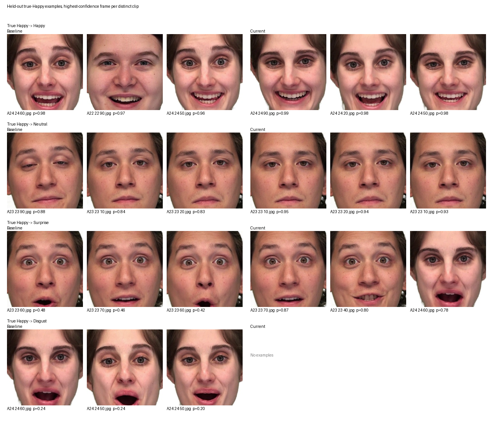

# Face Emotion Model: Controlled Evaluation

## Decision

Keep the existing AlexNet checkpoint trained with inverse-frequency weight strength 0.5. It has the best actor-held-out macro-F1 (0.3956) and Happy F1 (0.5781). The 0.25 experiment had three more correct validation frames, but lower macro-F1 and Happy F1; it is not selected. The 42-image diagnostic remains 12/42 for the baseline and current checkpoint, and was not used to tune or select models.

The measured gain is on RAVDESS held-out actors, not on real webcam footage. No natural webcam dataset is present, so webcam accuracy cannot be claimed.

## Dataset

All samples are 224x224 RGB face crops. Frames are labeled from the RAVDESS clip ID; every frame inherits its clip's emotion label. The training actors and validation actors remain disjoint (Actors 01-20 vs. 21-24).

| Emotion | Train images | Train % | Train clips | Validation images | Validation % | Validation clips |
|---|---:|---:|---:|---:|---:|---:|
| angry | 1,778 | 14.06% | 160 | 362 | 13.81% | 32 |
| disgust | 1,812 | 14.33% | 160 | 366 | 13.96% | 32 |
| fear | 1,623 | 12.83% | 160 | 338 | 12.90% | 32 |
| happy | 1,674 | 13.24% | 160 | 332 | 12.67% | 32 |
| neutral | 2,510 | 19.85% | 240 | 533 | 20.34% | 48 |
| sad | 1,657 | 13.10% | 160 | 371 | 14.15% | 32 |
| surprise | 1,593 | 12.60% | 160 | 319 | 12.17% | 32 |
| **Total** | **12,647** | **100%** | **1,200** | **2,621** | **100%** | **240** |

Neutral combines RAVDESS code 01 (neutral) and code 02 (calm). Training has 786 code-01 frames / 80 clips and 1,724 code-02 frames / 160 clips. Validation has 168 code-01 frames / 16 clips and 365 code-02 frames / 32 clips. Thus the neutral class is both larger and semantically mixed; calm contributes about 69% of its frames.

The image counts are not independent examples: consecutive frames from a clip are highly correlated. The validation set covers only four held-out actors and the same controlled recording domain.

## Experiments

The original baseline was trained with ImageNet AlexNet, unweighted CrossEntropyLoss, SGD (lr 0.016, momentum 0.9), StepLR (7, gamma 0.1), batch size 64, and frozen feature layers; it ran 41 of 50 epochs. Its best validation-accuracy checkpoint was epoch 26.

The initial 0.50 fine-tune changed several training choices together: it warm-started the baseline, unfroze `features.10` in addition to the selected classifier tensors (`classifier.1.bias`, `classifier.4`, `classifier.6`), used mild horizontal-flip/affine/color augmentation, AdamW (2e-5 / 1e-4 / 5e-4 layer-group learning rates, weight decay 1e-4), cosine decay, and selected by macro-F1. The controlled 0.00 and 0.25 ablations then used that same fine-tune configuration and identical baseline initialization; only class-weight strength changed. The weight formula is `(max_class_count / class_count) ** strength`, normalized to mean 1.

| Run | Weight strength | Best epoch / epochs run | Accuracy | Macro-F1 | Correct / 2,621 |
|---|---:|---:|---:|---:|---:|
| Original checkpoint | SGD, StepLR, unweighted CE; feature layers frozen | 26 / 41 | 37.39% | 0.3258 | 980 |
| Fine-tune | 0.50 | 15 / 20 | 41.59% | **0.3956** | 1,090 |
| Ablation | 0.00 (unweighted) | 4 / 9 (early stop) | 40.29% | 0.3562 | 1,056 |
| Ablation | 0.25 | 19 / 20 | **41.70%** | 0.3912 | **1,093** |

The 0.50 normalized weights in class order are `[1.000, 0.990, 1.046, 1.030, 0.841, 1.036, 1.056]`. The 0.25 weights are `[1.000, 0.996, 1.024, 1.016, 0.918, 1.018, 1.028]`; strength 0.00 uses all ones.

Removing weights reduced macro-F1 by 0.0394 relative to strength 0.50. Strength 0.25 was close but still 0.0044 lower in macro-F1. It gained only three correct images (0.11 percentage points in accuracy), while Happy F1 and recall were lower. The 0.50 checkpoint is therefore retained; this is not an accuracy-only selection.

## Per-Class Metrics

Baseline versus selected checkpoint, as requested:

| Emotion | Baseline Precision | New Precision | Baseline Recall | New Recall | Baseline F1 | New F1 |
|---|---:|---:|---:|---:|---:|---:|
| angry | 0.5545 | 0.6569 | 0.1685 | 0.1851 | 0.2585 | 0.2888 |
| disgust | 0.5146 | 0.6372 | 0.2896 | 0.3934 | 0.3706 | 0.4865 |
| fear | 0.4711 | 0.5120 | 0.1686 | 0.3166 | 0.2484 | 0.3912 |
| happy | 0.6150 | 0.7156 | 0.4187 | 0.4849 | 0.4982 | 0.5781 |
| neutral | 0.3236 | 0.3521 | 0.9381 | 0.8199 | 0.4812 | 0.4927 |
| sad | 0.2731 | 0.2806 | 0.1752 | 0.2534 | 0.2135 | 0.2663 |
| surprise | 0.2971 | 0.2827 | 0.1630 | 0.2508 | 0.2105 | 0.2658 |

F1 across the four evaluated checkpoints:

| Emotion | Baseline | Weight 0.00 | Weight 0.25 | Weight 0.50 (selected) |
|---|---:|---:|---:|---:|
| angry | 0.2585 | 0.2022 | 0.3367 | 0.2888 |
| disgust | 0.3706 | 0.4648 | 0.4906 | 0.4865 |
| fear | 0.2484 | 0.2947 | 0.3810 | 0.3912 |
| happy | 0.4982 | 0.5546 | 0.5441 | **0.5781** |
| neutral | 0.4812 | **0.5018** | **0.5019** | 0.4927 |
| sad | 0.2135 | 0.2124 | 0.2109 | **0.2663** |
| surprise | 0.2105 | 0.2632 | **0.2732** | 0.2658 |

## Confusion Matrices

Rows are true classes; columns are predicted classes. Order: angry, disgust, fear, happy, neutral, sad, surprise.

**Baseline**

| True \\ Predicted | angry | disgust | fear | happy | neutral | sad | surprise |
|---|---:|---:|---:|---:|---:|---:|---:|
| angry | 61 | 24 | 9 | 20 | 175 | 46 | 27 |
| disgust | 15 | 106 | 15 | 12 | 121 | 93 | 4 |
| fear | 8 | 14 | 57 | 4 | 172 | 25 | 58 |
| happy | 0 | 3 | 0 | 139 | 178 | 0 | 12 |
| neutral | 1 | 0 | 0 | 18 | 500 | 1 | 13 |
| sad | 5 | 47 | 0 | 18 | 227 | 65 | 9 |
| surprise | 20 | 12 | 40 | 15 | 172 | 8 | 52 |

**Selected, weight strength 0.50**

| True \\ Predicted | angry | disgust | fear | happy | neutral | sad | surprise |
|---|---:|---:|---:|---:|---:|---:|---:|
| angry | 67 | 27 | 3 | 6 | 153 | 58 | 48 |
| disgust | 12 | 144 | 6 | 6 | 106 | 88 | 4 |
| fear | 0 | 9 | 107 | 2 | 104 | 61 | 55 |
| happy | 0 | 0 | 12 | 161 | 128 | 1 | 30 |
| neutral | 0 | 0 | 15 | 19 | 437 | 10 | 52 |
| sad | 3 | 39 | 10 | 22 | 189 | 94 | 14 |
| surprise | 20 | 7 | 56 | 9 | 124 | 23 | 80 |

**Ablation, weight strength 0.00**

| True \\ Predicted | angry | disgust | fear | happy | neutral | sad | surprise |
|---|---:|---:|---:|---:|---:|---:|---:|
| angry | 46 | 59 | 5 | 11 | 167 | 50 | 24 |
| disgust | 16 | 162 | 13 | 12 | 115 | 44 | 4 |
| fear | 3 | 25 | 70 | 6 | 138 | 26 | 70 |
| happy | 0 | 3 | 3 | 170 | 136 | 0 | 20 |
| neutral | 0 | 2 | 3 | 33 | 478 | 1 | 16 |
| sad | 16 | 61 | 3 | 26 | 196 | 60 | 9 |
| surprise | 12 | 19 | 40 | 23 | 142 | 13 | 70 |

**Ablation, weight strength 0.25**

| True \\ Predicted | angry | disgust | fear | happy | neutral | sad | surprise |
|---|---:|---:|---:|---:|---:|---:|---:|
| angry | 83 | 38 | 2 | 4 | 152 | 36 | 47 |
| disgust | 17 | 157 | 8 | 4 | 113 | 66 | 1 |
| fear | 2 | 14 | 104 | 0 | 107 | 55 | 56 |
| happy | 0 | 0 | 9 | 142 | 147 | 1 | 33 |
| neutral | 0 | 0 | 17 | 13 | 462 | 1 | 40 |
| sad | 7 | 50 | 15 | 21 | 198 | 64 | 16 |
| surprise | 22 | 15 | 53 | 6 | 129 | 13 | 81 |

## Happy-Class Analysis

On the 332 held-out Happy frames:

| Model | Happy→Happy | Happy→Neutral | Happy→Surprise | Happy→Disgust | Other errors |
|---|---:|---:|---:|---:|---:|
| Baseline | 139 | 178 | 12 | 3 | 0 |
| Weight 0.00 | 170 | 136 | 20 | 3 | 3 → fear |
| Weight 0.25 | 142 | 147 | 33 | 0 | 9 → fear, 1 → sad |
| Weight 0.50 | 161 | 128 | 30 | 0 | 12 → fear, 1 → sad |

The selected model reduces Happy→Neutral by 50 frames and raises correct Happy predictions by 22 versus baseline, but Happy→Surprise rises from 12 to 30. The unweighted model has higher Happy recall (51.2%) but lower Happy precision/F1; strength 0.50 gives the best Happy F1 (0.5781) and a better overall macro-F1.

Visual samples indicate two distinct error sources. Some Happy-labeled frames show a closed mouth or only a weak/transitional smile and are confidently predicted Neutral; other staged Happy frames have wide eyes/open mouths and are predicted Surprise. Because the label belongs to the whole clip, early or transitional frames inherit Happy even when the visible face is close to neutral. Correctly classified samples show clear, broad smiles. This supports that the model learned some smile-related cues, but the frame labels and expression ambiguity limit reliability. Current Happy→Disgust was zero; the baseline had three such frames.

The contact sheet contains three high-confidence examples per available outcome, sampled from distinct clips. The CSV records model, prediction, confidence, actor, clip, frame, and source path. Current Happy→Disgust has no examples.

Detailed sample index: [vision_happy_diagnostics.csv](vision_happy_diagnostics.csv).

## Confusion Findings

- Happy→Neutral: 178 to 128; this is the main Happy improvement.
- Happy→Surprise: 12 to 30; this worsened and is consistent with visual ambiguity in wide-eyed/open-mouth frames.
- Angry→Neutral: 175 to 153.
- Fear→Neutral: 172 to 104; Fear→Sad rose from 25 to 61.
- Surprise→Neutral: 172 to 124; Surprise→Fear rose from 40 to 56.
- Disgust→Neutral: 121 to 106; Disgust→Sad remains high (93 to 88).
- Sad→Neutral remains a major error (227 to 189).

The 42-image diagnostic remains 12/42 for both baseline and selected checkpoint in the prior direct and Haar-crop comparison. It is drawn from the same held-out actors, so it is not an independent test set and was not used in the weighting experiments or model selection.

## Why Stop Here

The two controlled weighting ablations did not beat the selected model on macro-F1 or Happy F1. The midpoint reached its best late in training, but still finished below the 0.50 run; the unweighted run peaked early and then overfit. The 42-frame diagnostic did not move. More optimizer/weight sweeps against these same correlated clips risk fitting the four validation actors and their clip-level label noise rather than improving webcam transfer. The next justified step is better labeled, webcam-like data, not more epochs or another broad hyperparameter sweep.

## Real-Webcam Limits

The data are tightly framed, pre-cropped, acted RAVDESS expressions. The mild affine/color augmentation does not create natural partial smiles, spontaneous expression onset/offset, varied rooms, real camera distance, motion blur, occlusion, or realistic webcam exposure changes. The actor-held-out result demonstrates improvement within this dataset only. No labeled real-webcam evaluation set is available, so webcam accuracy is unknown.

To establish webcam generalization, add consented webcam-style face crops with per-frame (not whole-clip-only) labels. Include natural broad and subtle smiles, neutral faces, partial/onset/offset smiles, open-mouth non-smiles, varied lighting and camera distance, head pose, occlusions, image quality, and a diverse set of subjects. Keep subjects disjoint across train/validation/test and balance clips/subjects, not just adjacent frames. Have ambiguous frames independently labeled or marked uncertain.

## Integration Verification

The selected 0.50 checkpoint remains at `models/vision/model_image_new50.pth`; the pre-fine-tune checkpoint is preserved at `models/vision/model_image_new50_baseline_before_finetune.pth`. Class order remains `[angry, disgust, fear, happy, neutral, sad, surprise]`. The existing inference loader returns 224x224 RGB crops, applies ImageNet normalization, runs the model in eval mode, and returns finite probabilities summing to one. No additional frontend or other-modality files were changed for these experiments.

Verification: `pytest tests/test_api.py::test_vision_prediction_success -q` passed (1 test); frontend API tests passed (8 tests); `npm run build` passed. A final default-loader check confirmed the selected checkpoint is active, eval mode is on, input crop is 224x224 RGB, class order is correct, and finite probabilities sum to 1.
